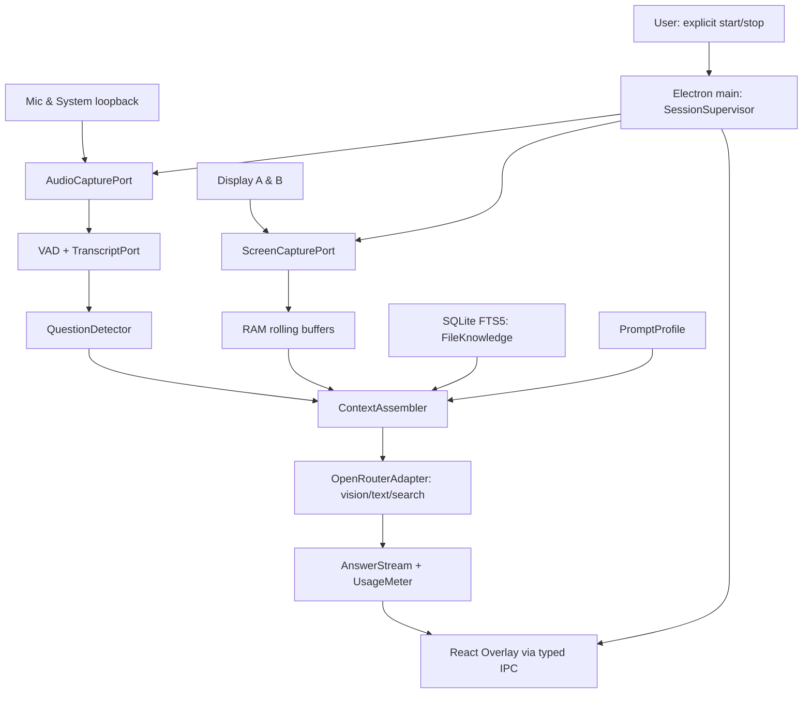

# Архітектура та технічні рішення AURA DESK

## 1. Стратегія

**Modular monolith в Electron.** No remote backend. UI і OS/API access жорстко розмежовані; чиста бізнес-логіка не залежить від Electron. Помірна модульність, без імітації enterprise-системи.

### Tech baseline (зафіксувати сумісні версії під час bootstrap)

- Electron; electron-vite (Vite-based build), Node bundled with Electron; React + TypeScript strict.
- Tailwind CSS v4 + shadcn/ui локальні компоненти + Radix primitives + Lucide (тільки потрібні компоненти).
- Zod (IPC, settings, imported profiles, model metadata), Zustand тільки для renderer local UI-state якщо треба.
- SQLite з FTS5; для Electron native module (напр., `better-sqlite3`) **після compatibility-spike** і electron rebuild; альтернатива обирається через ADR, якщо збірка блокує MVP.
- Vitest для pure core; @testing-library/react для UI; Playwright Electron для smoke E2E, ESLint + TypeScript + Prettier.
- Системне аудіо: Electron capture loopback коли Windows-спайк підтвердить; fallback .NET 8 Windows helper + NAudio (додатковий процес через IPC/stdio). Не додавати helper заздалегідь без потреби.
- Local STT: opt-in `whisper.cpp` binary adapter **після ліцензійної/Windows перевірки**; remote STT тільки якщо модель/endpoint фактично підтримує формат; abstraction незалежна від конкретного постачальника.
- OpenRouter HTTPS із main-process; Chat Completions або Responses API обирати після live capability spike, не змішувати форми в одному адаптері.

## 2. Діаграма потоків



## 3. Процеси та межі довіри

- **main**: policy/permissions/session, storage, API key, network, file read, model registry, budget caps, IPC endpoints (validates all inputs), loopback process supervision.
- **preload**: вузький explicit API via `contextBridge`; жодного `ipcRenderer` напряму в renderer; typed methods + event subscriptions with cleanup.
- **renderer**: UI + React components; no Node integration, no secrets, no arbitrary file system/network access; treats model text as untrusted markdown.
- **optional helper**: capture / STT subprocess; мінімальна протокольна поверхня, bounded IO, orderly shutdown.
- **core**: TypeScript pure modules for question logic, context selection, prompt composition, pricing calculations, state machine; mocks available.

Security defaults: `contextIsolation: true`, `nodeIntegration: false`, `sandbox: true` where supported, restrictive CSP, never load untrusted URLs in privileged renderer. See `docs/SECURITY_PRIVACY.md`.

## 4. Suggested future source tree

```text
src/
  main/
    bootstrap.ts
    windows/          # main + overlay windows
    ipc/              # validated handlers
    capture/          # screen/audio adapters and supervisor
    openrouter/       # HTTPS provider, model capabilities, cost
    knowledge/        # extractors + SQLite FTS5
    storage/          # settings/keys + migrations
  preload/
    index.ts          # narrow typed contextBridge
  renderer/
    app/              # routes/providers
    features/
      session/
      displays/
      audio/
      models/
      prompts/
      knowledge/
      overlay/
      usage/
    components/ui/    # shadcn primitives (do not rewrite gratuitously)
    styles/
  core/
    session/          # pure state transitions
    questions/
    context/
    prompts/
    contracts/        # Zod schemas, discriminated unions
    privacy/
  shared/
    types/
  test/
    fixtures/         # screenshots synthetic only, fake transcripts
    helpers/
```

> Структура — напрямок, не вимога створювати десятки порожніх файлів одразу. Один файл за змістовний крок і коміт.

## 5. Основні контракти (опис, реалізувати в TS після спайків)

```ts
type CaptureSelection =
  | { mode: 'both' }
  | { mode: 'single'; displayId: string };

type SessionStatus = 'idle' | 'starting' | 'active' | 'paused' | 'stopping' | 'error';
type SourceKind = 'mic' | 'system-audio' | 'display' | 'file' | 'web';
interface Observation {
  id: string;
  atMs: number;
  source: SourceKind;
  sourceId?: string;
  // typed payload handled at boundary; no raw image in Redux/React state
}
interface ScreenCapturePort {
  listDisplays(): Promise<Array<{ id: string; label: string; width: number; height: number; primary: boolean }>>;
  start(selection: CaptureSelection): Promise<void>;
  change(selection: CaptureSelection): Promise<void>;
  stop(): Promise<void>;
}
interface AudioCapturePort { start(config: { mic: boolean; system: boolean }): Promise<void>; stop(): Promise<void>; }
interface TranscriberPort { transcribe(sourceId: string, bytes: Uint8Array, signal: AbortSignal): Promise<string>; }
interface ModelAdapter {
  listSupportedModels(): Promise<ReadonlyArray<{ id: string; vision: boolean; tools: boolean; contextLength?: number }>>;
  complete(input: AgentRequest, signal: AbortSignal): AsyncIterable<AgentEvent>;
}
interface KnowledgePort { search(query: string, limit: number): Promise<SourceChunk[]>; }
```

- `AgentRequest` і `AgentEvent` мають Zod validation, але специфікація exact provider payload ізолюється у `OpenRouterAdapter`.
- Потоки ніколи не зберігати в загальному глобальному mutable store без owner; SessionSupervisor відповідає за lifecycle.
- `DisplayId` фактичний hardware mapping може змінитися після hotplug; при зміні інвалідовувати/переобирати.

## 6. Станова машина

`idle → starting → active ↔ paused → stopping → idle`; помилка при старті `starting → error`, recovery тільки через explicit retry або Stop. `stop()` idempotent; будь-який перехід до stopped abort-ить `AbortController` API requests, закриває media tracks, завершує helper. З active на active при зміні екрану — атомарна заміна дозволених capture targets; не повинно бути періоду захоплення забороненого дисплея.

## 7. Алгоритм local observation / inference

1. Local screen sampling independent per allowed display every 2s by default, bound memory ring buffer max ~120 sec + max byte count.
2. Per-frame change hash/ROI; duplicate frames drop; no accidental screen disk writes.
3. Audio chunking + VAD + transcription with time/source tagging; cancel on Stop.
4. Question detector on finalized segments: confidence, repeated candidate, debounce, 10–30s cooldown adjustable; queue max 1. DO NOT claim speaker identity without evidence.
5. Event trigger from user hotkey OR validated auto question; ContextAssembler collects recent question/context, max frames per selected monitor, FTS matches, profile, summary; calculate rough cost & privacy redaction.
6. API request to configured **supported** model; stream final answer. Tool calls for search allowlisted and usage-budget gated. Main validates returned tool args and prevents arbitrary functions.
7. Overlay renders answer + source tags; optionally saves text answer and short metadata in SQLite if enabled. Flush transient images/audio from RAM when TTL expires or Stop.

## 8. Display selection semantics

- `both`: capture display A and B selected from enumerated available, no automatic active-window magic.
- `single`: capture exactly selected `displayId`. On switch from both, STOP unselected stream before next capture cycle; clear all old-frame references for disabled screen.
- Missing monitor: show warning and pause that capture; **do not silently switch** to a different display and leak content.
- Overlay default monitor configurable separately from capture mode; overlay ideally excluded from its own capture (Windows test required).

## 9. Knowledge indexing

SQLite tables conceptual: `settings`, `sessions`, `transcript_segments`, `profiles`, `knowledge_sources`, `knowledge_chunks`, `knowledge_fts` virtual table, `answers`, `usage_events`. Index file path + hash + modified time; chunk by approx token windows with overlap; store provenance `file/path/section/page` when available. PDF scanned images require OCR later; do not pretend extracted text exists. Avoid indexing credentials/secrets and user-selected excluded directories. SQLite migration scripts versioned, tested.

## 10. OpenRouter boundary and fallbacks

- Distinguish text+images, text-only, tool calls, audio-to-text: support varies per model AND endpoint. Never send arbitrary unsupported payload.
- Model manager queries models metadata and validates capability; fallback only to **user-approved** model and budget.
- No automatic model downgrade to unknown or provider with different data logging properties.
- Web search integration uses **current** supported OpenRouter tool API; no deprecated plugin copied from outdated examples. Optional local search backend later if needed.
- Report actual usage if returned; if unavailable mark **estimate** not factual billing.

## 11. Architectural decision gates

- ADR-001 Electron/electron-vite vs Tauri: Electron chosen for TS ecosystem and capture APIs; verify Windows media support.
- ADR-002 remote STT vs local whisper: spike first, choose default based on latency/resources/privacy.
- ADR-003 SQLite native module: evaluate packaging/ABI, don't force before evaluation.
- ADR-004 OpenRouter request API: compare Chat vs Responses for required image/tool streaming before locking integration.

## 12. Quality bars

- Interfaces at OS/provider boundaries; core pure, no `any` unless justified narrowly; avoid over-engineered abstract factories.
- UI no direct `ipcRenderer` access, no network from renderer; form state validated.
- `≤200` lines preferred for React feature component, `≤300` for services *guideline*, split when one responsibility becomes unclear; do not artificially split.
- One feature via 1-file commits, with separate tests/doc commits; avoid breaking main branch if sequencing allows; if not, use feature branch and CI validation before merge.
