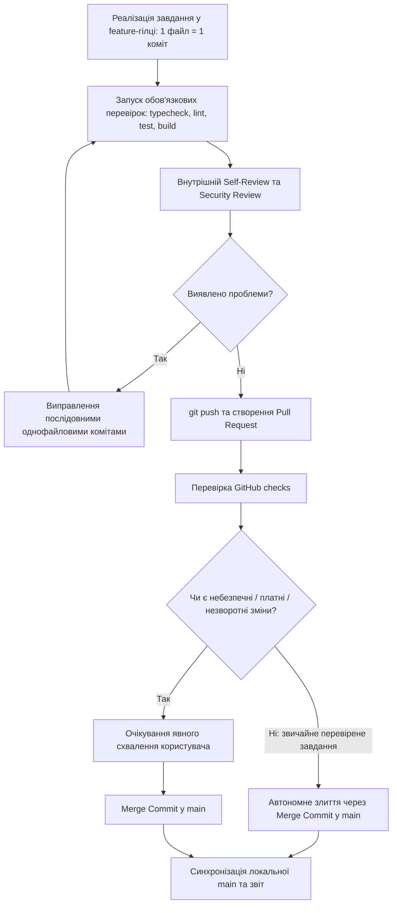

# Регламент розробки: Feature Branches, Atomic Commits та Pull Request Policy

> **Статус:** Обов'язкове постійне правило проєкту AURA DESK. Усі наступні завдання виконуються виключно за цим регламентом.

---

## 1. Загальні положення та життєвий цикл завдань

Розробка AURA DESK ведеться за моделлю ізольованих feature-гілок із обов'язковим відкриттям Pull Request, проходженням перевірок якості, суворим самостійним review та злиттям виключно через **Merge Commit** у гілку `main`.

Кожне завдання з `docs/ROADMAP.md` проходить такі стани:
1. **TODO** — завдання в черзі.
2. **IN PROGRESS** — створено окрему feature-гілку, ведеться покрокова реалізація (1 файл = 1 коміт).
3. **IMPLEMENTED** — код реалізовано, виконано локальні перевірки, self-review та security review.
4. **IN REVIEW** — feature-гілку опубліковано на GitHub, відкрито Pull Request, перевірено GitHub checks.
5. **MERGED** — обов'язкові перевірки пройдено, блокуючих ризиків немає, PR злито в `main` через Merge Commit (автономно для авторизованих звичайних завдань або після додаткового погодження для high-risk змін).

> [!IMPORTANT]
> Відкритий або реалізований PR **не дорівнює MERGED**. У `docs/ROADMAP.md` та `docs/PROGRESS.md` статус завдання оновлюється відповідно до реального стану.

---

## 2. Обов'язковий Feature Branch та Autonomous Workflow

Для кожного наступного звичайного завдання з Roadmap діє автономний інженерний регламент:

1. **Визначити завдання та перевірити документацію:**
   - Ознайомитися з `AGENTS.md`, `docs/PRODUCT_SPEC.md`, `docs/ARCHITECTURE.md`, `docs/ENGINEERING_LESSONS.md`.
2. **Preflight-перевірка та синхронізація:**
   - Перевірити стан: `git status` (робоче дерево має бути абсолютно чистим).
   - Синхронізувати `main`: `git switch main` та `git pull --ff-only origin main`.
3. **Створення feature-гілки:**
   - Створити нову гілку від актуальної `main`:
     * `feat/<task-id>-<description>` — нова функціональність.
     * `fix/<task-id>-<description>` — виправлення дефекту.
     * `refactor/<task-id>-<description>` — рефакторинг без зміни поведінки.
     * `test/<task-id>-<description>` — додавання/оновлення тестів.
     * `docs/<task-id>-<description>` — документація, регламенти, промпти.
4. **Реалізація завдання:**
   - Реалізувати **рівно одне** завдання з Roadmap.
   - Дотримуватися принципу атомарних комітів (**1 файл = 1 коміт**).
5. **Локальні перевірки:**
   - Виконати обов'язкові перевірки: `npm run typecheck`, `npm run lint`, `npm run test:unit`, `npm run test:ui`, `npm run build`, `py -3 scripts/verify-one-file-history.py`.
6. **Self-review та Security Review:**
   - Провести внутрішнє рецензування коду та перевірку безпеки (відсутність витоку ключів, ізоляція процесів Electron, відсутність зайвих залежностей).
   - Усунути всі виявлені дефекти послідовними однофайловими комітами.
7. **Оновлення Roadmap і Progress:**
   - Оновити `docs/ROADMAP.md` та `docs/PROGRESS.md` окремими однофайловими комітами за фактичними результатами.
8. **Публікація та Pull Request:**
   - Запушити feature-гілку на GitHub: `git push -u origin <branch-name>`.
   - Створити Pull Request у `main` за встановленим шаблоном (`gh pr create`).
9. **Перевірка обов'язкових checks:**
   - Перевірити стан GitHub checks (`gh pr checks` / `gh pr view`).
10. **Автономне злиття (Autonomous Merge):**
    - Якщо перевірки успішні, немає критичних блокерів і завдання належить до авторизованого обсягу звичайних завдань — **самостійно виконати злиття PR у `main` через Merge Commit** (`gh pr merge <pr-number> --merge`).
    - Окреме ручне погодження користувача потрібне **тільки** для небезпечних, незворотних, платних або суттєвих змін безпеки й приватності, якщо вони виходять за межі ТЗ.
11. **Синхронізація та фіксація:**
    - Перевірити результат злиття, переключитися на локальну `main` та виконати `git pull --ff-only origin main`.
    - Надати фінальний звіт про виконання.

---

## 3. Сувора політика атомарних комітів (Atomic Commits — STRICT)

**ONE FILE = ONE COMMIT. NO EXCEPTIONS.**

1. **Рівно один файл на коміт:** Кожен коміт змінює строго один шлях у файловій системі. Це стосується вихідного коду, тестів, конфігурацій, документації та виправлень.
2. **Conventional Commits:** Обов'язковий формат заголовка: `type(scope): description`.
3. **Локальні хуки:** `.githooks/pre-commit` та `.githooks/commit-msg` діють постійно (`core.hooksPath = .githooks`). Будь-який обхід через `--no-verify`, вимкнення хуків чи зміну конфігурації **суворо заборонено**.
4. **Заборонені операції:**
   - `git add .`, `git add -A`, `git commit -am`.
   - Squash merge, rebase merge або будь-яке переписування історії комітів.
   - `git push --force` або `--force-with-lease`.
5. **Аудит історії та Merge Commits:** Кожен коміт реалізації, тестів або документації суворо перевіряється на рівно 1 змінений файл. Технічні інтеграційні Merge Commits, створені під час злиття схваленого Pull Request у `main`, є сполучними ланками топології історії, а не комітами модифікації файлів. Валідатор `scripts/verify-one-file-history.py` чітко розрізняє їх:
   - Для звичайних комітів діє непорушна вимога: строго 1 файл на коміт.
   - Для merge commits валідатор перевіряє виключно технічну структуру: наявність рівно двох батьків (`len(parents) == 2`) та відповідність документованій конвенції GitHub PR-злиття (`Merge pull request #<num>...`). Локальні повідомлення злиття гілок (`Merge branch '...'`) відхиляються, оскільки регламент вимагає злиття виключно через GitHub Pull Request.
   - Відповідність заголовка merge commit конвенції свідчить лише про структурну коректність у Git і НЕ є доказом схвалення користувачем. Реальне схвалення підтверджується виключно процедурою незалежного review (ChatGPT) та явним дозволом користувача перед створенням merge commit.
   - Будь-які octopus-мерджі (>2 батьків), довільні повідомлення злиття (наприклад, `Merge arbitrary changes`) або некоректні багатофайлові звичайні коміти категорично заборонені.
   - Валідатор стійкий до некоректних Git-ревізій і повертає стандартизований кортеж `(passed, issues, summary)` з ненульовим exit code без аварійного завершення.
   - Створено автоматичні регресійні тести валідатора (`scripts/test-verify-one-file-history.py`).

---

## 4. Обов'язковий Pull Request (Mandatory PR)

Після завершення реалізації завдання та локальних перевірок автоматично створюється Pull Request за допомогою GitHub CLI (`gh pr create`) або надається повний структурований шаблон.

### Обов'язковий зміст опису PR:
- **Task ID:** ID завдання з Roadmap.
- **Мета:** Чітке пояснення бізнес-/технічної мети.
- **Опис реалізації:** Короткий виклад архітектурних рішень та змін.
- **Перелік змінених файлів:** Список файлів із призначенням.
- **Результати тестування:** Таблиця результатів (PASS / FAIL / NOT RUN) із зазначенням команд.
- **Security & Privacy:** Перевірка відсутності секретів, збереження ізоляції процесів Electron, відсутність небезпечних IPC.
- **Відомі ризики та обмеження:** Платформенні особливості, відкриті ADR.
- **Критерії ручної перевірки:** Точні інструкції та команди для користувача.

Якщо завдання містить невирішені питання або потребує попереднього обговорення, створюється **Draft PR**.

---

## 5. Рецензування коду (Code Review Policy)

Усі зміни проходять обов'язковий багаторівневий контроль якості:

1. **Внутрішній Self-Review агента:**
   - Перед створенням PR агент обов'язково проводить ретельний self-review та security audit (пошук дефектів, race conditions, неперевірених assumptions, витоку секретів, збереження 1 файл = 1 коміт).
   - Внутрішній self-review є обов'язковим інженерним фільтром, але чесно відрізняється від незалежного зовнішнього review.
2. **Незалежний Code Review (ChatGPT / Користувач):**
   - Користувач за власним бажанням може у будь-який момент надати створений PR на незалежний review у чаті ChatGPT (оцінка ТЗ, архітектури, повноти тестів та ризиків).
   - Зауваження незалежного review усуваються агентом у тій самій feature-гілці послідовними однофайловими комітами.
3. **Повна заборона автоматичного виклику Codex та платних AI:**
   - Категорично заборонено публікувати в GitHub `@codex review`, `@codex security review`, `@codex address that feedback`.
   - Заборонено запускати Codex Cloud tasks, Codex CLI/extensions/API або автоматичні платні GitHub AI reviews, щоб не витрачати платні ліміти користувача.
   - Відсутність автоматичного Codex Review у GitHub ніколи не є блокером.

---

## 6. Політика злиття (Merge Policy)

**Автономне злиття авторизоване для звичайних перевірених завдань:**

1. **Автономне злиття (Autonomous Merge Commit):**
   - Агент уповноважений самостійно зливати Pull Request у гілку `main`, якщо:
     * Завдання належить до узгодженого Roadmap, швидкого MVP або рефакторингу;
     * Усі обов'язкові локальні перевірки (`typecheck`, `lint`, `test`, `build`, `verify-one-file-history`) пройшли успішно;
     * GitHub checks (якщо налаштовані) мають статус CLEAN/SUCCESS;
     * Немає конфліктів і ризиків порушення безпеки чи приватності.
2. **Випадки, що вимагають явного ручного схвалення користувача:**
   - Небезпечні або незворотні дії (деструктивні операції, модифікація налаштувань сховища, видалення великих модулів);
   - Фінансово витратні операції (активація живих платних запитів до OpenRouter або хмарних сервісів);
   - Суттєві зміни політики безпеки та приватності (розширення захоплення екрана/звуку поза згоду користувача).
3. **Суворо заборонено:**
   - Squash merge (знищує атомарну історію однофайлових комітів).
   - Rebase merge (переписує хеші комітів).
   - Force push (`git push --force`).
   - Пушити нові зміни напряму в `main` в обхід feature-гілок та PR.
4. **Спосіб злиття:**
   Злиття виконується на GitHub через стандартний механізм **Create a merge commit** (`gh pr merge <pr-number> --merge`). Це зберігає повну топологію однофайлових комітів в історії `main`.

---

## 7. Тестування та ефективність токенів

1. **Автоматичні дешеві перевірки:**
   - `npm run typecheck`
   - `npm run lint`
   - `npm run test:unit`
   - `npm run test:ui`
   - `npm run build`
   - `py -3 scripts/verify-one-file-history.py`
2. **Заборонені без окремого дозволу:**
   - Важкі навантажувальні чи довготривалі тести.
   - Повні набори Playwright E2E.
   - Реальні тести захоплення екрана та системного звуку на Windows.
   - Платні запити до OpenRouter API.
   - Автоматичні виклики GitHub Codex reviews або інші платні зовнішні AI-сервіси.
3. **Економія токенів:**
   - Не перечитувати весь репозиторій перед кожним кроком.
   - Завантажувати лише безпосередньо релевантні файли та скіли.
