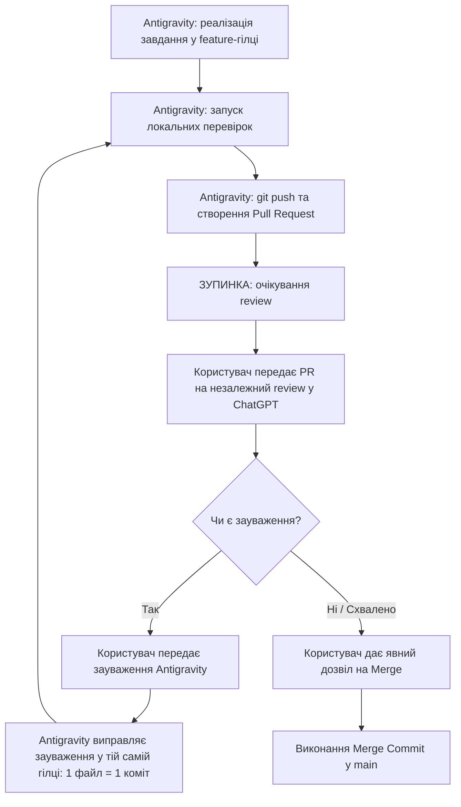

# Регламент розробки: Feature Branches, Atomic Commits та Pull Request Policy

> **Статус:** Обов'язкове постійне правило проєкту AURA DESK. Усі наступні завдання виконуються виключно за цим регламентом.

---

## 1. Загальні положення та життєвий цикл завдань

Розробка AURA DESK ведеться за моделлю ізольованих feature-гілок із обов'язковим відкриттям Pull Request та проходженням **незалежного code review** перед злиттям у гілку `main`.

Кожне завдання з `docs/ROADMAP.md` проходить такі стани:
1. **TODO** — завдання в черзі.
2. **IN PROGRESS** — створено окрему feature-гілку, ведеться покрокова реалізація.
3. **IMPLEMENTED** — код реалізовано локально, виконано дешеві тести, проведено self-review та security review.
4. **IN REVIEW** — feature-гілку опубліковано на GitHub, відкрито Pull Request, очікується незалежний review від ChatGPT/користувача.
5. **MERGED** — незалежний review пройдено успішно, отримано явне підтвердження користувача, PR злито в `main`.

> [!IMPORTANT]
> Відкритий або реалізований PR **не дорівнює MERGED**. У `docs/ROADMAP.md` та `docs/PROGRESS.md` статус завдання оновлюється відповідно до реального стану.

---

## 2. Обов'язковий Feature Branch Workflow

Для **кожного** наступного завдання з Roadmap виконується така послідовність дій:

1. **Preflight-перевірка:**
   - Перевірити стан Git: `git status`.
   - Робоче дерево має бути абсолютно чистим (`working tree clean`).
2. **Синхронізація з базою:**
   - Переключитися на `main`: `git checkout main`.
   - Отримати актуальний стан: `git fetch origin` та `git pull --ff-only origin main`.
3. **Створення feature-гілки:**
   - Створити нову гілку від актуальної `main`:
     * `feat/<task-id>-<description>` — нова функціональність.
     * `fix/<task-id>-<description>` — виправлення дефекту.
     * `refactor/<task-id>-<description>` — рефакторинг без зміни поведінки.
     * `test/<task-id>-<description>` — додавання/оновлення тестів.
     * `docs/<task-id>-<description>` — документація, регламенти, промпти.
4. **Реалізація завдання:**
   - Реалізувати **рівно одне** завдання з Roadmap.
   - Дотримуватися принципу атомарних комітів (1 файл = 1 коміт).
5. **Локальні перевірки:**
   - Виконати дешеві перевірки: `npm run typecheck`, `npm run lint`, `npm run test:unit`, `npm run test:ui`, `npm run build`, `py -3 scripts/verify-one-file-history.py`.
6. **Оновлення Roadmap і Progress:**
   - Оновити `docs/ROADMAP.md` та `docs/PROGRESS.md` окремими однофайловими комітами за фактичними результатами.
7. **Публікація та Pull Request:**
   - Запушити feature-гілку на GitHub: `git push -u origin <branch-name>`.
   - Створити Pull Request у `main` за встановленим шаблоном.
8. **Зупинка:**
   - **Зупинитися** та надати користувачу посилання на відкритий Pull Request для незалежного review.
   - Не починати нове завдання.

> [!NOTE]
> Якщо під час review виявлено зауваження, виправлення вносяться **в ту саму feature-гілку** новими однофайловими комітами. Нова гілка для виправлень не створюється.

---

## 3. Сувора політика атомарних комітів (Atomic Commits — STRICT)

**ONE FILE = ONE COMMIT. NO EXCEPTIONS.**

1. **Рівно один файл на коміт:** Кожен коміт змінює строго один шлях у файловій системі. Це стосується вихідного коду, тестів, конфігурацій, документації та виправлень.
2. **Conventional Commits:** Обов'язковий формат заголовка: `type(scope): description`.
3. **Локальні хуки:** `.githooks/pre-commit` та `.githooks/commit-msg` діють постійно (`core.hooksPath = .githooks`). Будь-який обхід через `--no-verify`, вимкнення хуків чи зміну конфігурації **суворо заборонено**.
4. **Заборонені операції:**
   - `git add .`, `git add -A`, `git commit -am`.
   - Squash merge, rebase merge або будь-яке переписування історії комітів.
   - `git push --force` або `--force-with-lease`.
5. **Аудит історії та Merge Commits:** Кожен коміт реалізації, тестів або документації суворо перевіряється на рівно 1 змінений файл. Технічні інтеграційні Merge Commits, створені під час злиття схваленого Pull Request у `main`, є сполучними ланками топології історії, а не комітами модифікації файлів. Валідатор `scripts/verify-one-file-history.py` чітко розрізняє їх:
   - Для звичайних комітів діє непорушна вимога: строго 1 файл на коміт.
   - Для merge commits валідатор перевіряє виключно технічну структуру: наявність рівно двох батьків (`len(parents) == 2`) та відповідність документованій конвенції GitHub PR-злиття (`Merge pull request #<num>...`). Локальні повідомлення злиття гілок (`Merge branch '...'`) відхиляються, оскільки регламент вимагає злиття виключно через GitHub Pull Request.
   - Відповідність заголовка merge commit конвенції свідчить лише про структурну коректність у Git і НЕ є доказом схвалення користувачем. Реальне схвалення підтверджується виключно процедурою незалежного review (ChatGPT) та явним дозволом користувача перед створенням merge commit.
   - Будь-які octopus-мерджі (>2 батьків), довільні повідомлення злиття (наприклад, `Merge arbitrary changes`) або некоректні багатофайлові звичайні коміти категорично заборонені.
   - Валідатор стійкий до некоректних Git-ревізій і повертає стандартизований кортеж `(passed, issues, summary)` з ненульовим exit code без аварійного завершення.
   - Створено автоматичні регресійні тести валідатора (`scripts/test-verify-one-file-history.py`).

---

## 4. Обов'язковий Pull Request (Mandatory PR)

Після завершення реалізації завдання та локальних перевірок автоматично створюється Pull Request за допомогою GitHub CLI (`gh pr create`) або надається повний структурований шаблон.

### Обов'язковий зміст опису PR:
- **Task ID:** ID завдання з Roadmap.
- **Мета:** Чітке пояснення бізнес-/технічної мети.
- **Опис реалізації:** Короткий виклад архітектурних рішень та змін.
- **Перелік змінених файлів:** Список файлів із призначенням.
- **Результати тестування:** Таблиця результатів (PASS / FAIL / NOT RUN) із зазначенням команд.
- **Security & Privacy:** Перевірка відсутності секретів, збереження ізоляції процесів Electron, відсутність небезпечних IPC.
- **Відомі ризики та обмеження:** Платформенні особливості, відкриті ADR.
- **Критерії ручної перевірки:** Точні інструкції та команди для користувача.

Якщо завдання містить невирішені питання або потребує попереднього обговорення, створюється **Draft PR**.

---

## 5. Незалежний Code Review (Independent Review Policy)

Усі Pull Requests проходять обов'язкову незалежну експертизу:

1. Власний self-review агента **не замінює** незалежний review.
2. ChatGPT у звичайному чаті проводить незалежний review (оцінює відповідність ТЗ, архітектуру, повноту тестів, безпеку Electron та ризики) без запуску автоматичного Codex Cloud.
3. **Повна заборона автоматичного виклику Codex та платних AI:**
   - Категорично заборонено публікувати в GitHub `@codex review`, `@codex security review`, `@codex address that feedback`.
   - Заборонено запускати Codex Cloud tasks, Codex CLI/extensions/API або автоматичні GitHub AI reviews, щоб не витрачати платні ліміти користувача.
   - Відсутність автоматичного Codex Review у GitHub **не є підставою для блокування PR**, якщо пройдено перевірку в чаті ChatGPT та виконано локальні технічні тести.
   - Попередні коментарі Codex можуть залишатися в історії для контексту, але нові виклики заборонені за замовчуванням.
4. Зауваження усуваються послідовними однофайловими комітами в наявній feature-гілці.

---

## 6. Політика злиття (Merge Policy — ABSOLUTE)

**AUTOMATIC MERGE IS FORBIDDEN.**

**Суворо заборонено без явного дозволу користувача:**
- Зливати (Merge) Pull Request у гілку `main`.
- Робити Squash merge (знищує атомарну історію однофайлових комітів).
- Робити Rebase merge.
- Пушити коміти нових завдань напряму в `main`.
- Видаляти feature-гілку до підтвердження успішного злиття.

**Спосіб злиття після погодження:**
Після отримання схвалення за результатами незалежного review (ChatGPT) та явного дозволу користувача злиття виконується на GitHub через стандартний механізм **Create a merge commit** (у вебі або через `gh pr merge <pr-number> --merge`).
Не слід вимагати виконання локального `git merge --no-ff`, якщо діючі локальні хуки для звичайних комітів перешкоджають локальному злиттю.
Стандартний GitHub Merge Commit створює двобатьківський інтеграційний коміт, повністю зберігаючи всю послідовність атомарних комітів feature-гілки в історії `main`.

---

## 7. Тестування та ефективність токенів

1. **Автоматичні дешеві перевірки:**
   - `npm run typecheck`
   - `npm run lint`
   - `npm run test:unit`
   - `npm run test:ui`
   - `npm run build`
   - `py -3 scripts/verify-one-file-history.py`
2. **Заборонені без окремого дозволу:**
   - Важкі навантажувальні чи довготривалі тести.
   - Повні набори Playwright E2E.
   - Реальні тести захоплення екрана та системного звуку на Windows.
   - Платні запити до OpenRouter API.
   - Автоматичні виклики GitHub Codex reviews або інші платні зовнішні AI-сервіси.
3. **Економія токенів:**
   - Не перечитувати весь репозиторій перед кожним кроком.
   - Завантажувати лише безпосередньо релевантні файли та скіли.
